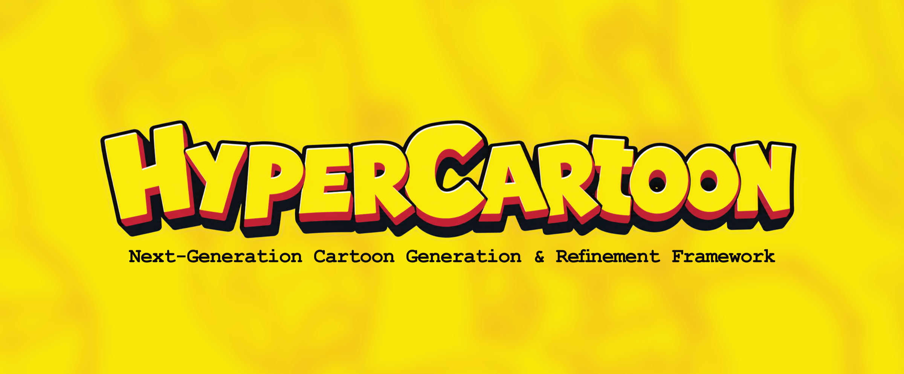

# Hypercartoon



**Learn a cartoon from a folder of episodes or a YouTube playlist. Write a script. Get the episode back with the same look, voices, emotions and mouth movement, up to 1440×960.**

     

[What it is](#what-is-hypercartoon) · [Improvements over TTT-Video](#improvements-over-ttt-video) · [Features](#features) · [Studio](#the-studio) · [Engines](#generation-engines) · [1440×960](#the-1440960-format) · [Timings](#timings) · [Quick start](#quick-start) · [Status](#status--what-has-and-has-not-been-run)

---

## What is Hypercartoon?

A **framework for producing cartoons** with two halves:

| Half | What it is | Where |
|---|---|---|
| 🧠 **The engine** | A video diffusion transformer — CogVideoX‑5B with test‑time‑training ("Hyper") layers — that keeps up to **63 s** of video coherent, trained in stages of 3 → 9 → 18 → 30 → 63 s. Derived from [TTT‑Video](https://github.com/test-time-training/ttt-video-dit). | `hypercartoon/`, `train.py`, `sample.py` |
| 🎛️ **The studio** | Everything around the engine: it studies your episodes, reads your script, plans the compute, regenerates voices, emotions and lip‑sync, drives local generation engines, refines the result to **1440×960** and measures whether it got better. | `studio/` — [explained below](#the-studio) |

The engine alone is a research model you feed with hand‑prepared data. The studio turns it into a workflow: **folder or URL in → project kit → script in → episode out**.

```
 episodes/ · URLs · lists     ┌────────────── LEARN ──────────────┐            ┌──────────── CREATE ────────────┐
  S01/E01.mp4                 │ shots · camera · framing · colour │            │ script / prompt                │
  youtube.com/playlist?…  ──▶ │ characters · voices · mouths      │   project  │  ▶ story check + auto-fixes    │
  magnet:?xt=…                │ layers · sound bank · emotion     │ ─────────▶ │  ▶ emotion per line            │ ─▶ video engine (720×480)
                              │ training set · sufficiency report │    kit     │  ▶ compute plan (cache, steps) │ ─▶ voices + ambience + mouths
                              └───────────────────────────────────┘            │  ▶ prompts + audio controls    │ ─▶ stage B: 1440×960
                                                                               └────────────────────────────────┘
```

---

## Improvements over TTT-Video

The core model is the same. What Hypercartoon adds, and how far each addition has been proven (see the [status](#status--what-has-and-has-not-been-run) for the details):

| Area | TTT‑Video | Hypercartoon | Proof |
|---|---|---|---|
| **Data in** | Pre‑computed latents and text embeddings you prepare by hand | A folder, URL, YouTube playlist, URL list, open directory, RSS feed, cloud link, live stream or torrent; only a 480 p proxy is kept | Run on a real YouTube playlist |
| **Seasons and shows** | Not modelled | Series / season / episode inferred from paths and titles; per‑show and per‑studio knowledge layers; style fusion between shows | CPU tests, real playlist |
| **Dataset** | Written by hand | Clips per stage, captions every 3 s (heuristic or Qwen2.5‑VL), scene flags, the exact files `train.py` reads | CPU tests |
| **Training plan** | You pick the stages | Planned from the material and the GPU memory, plus a sufficiency report (minutes missing per capability) | CPU tests |
| **Text and logos in the picture** | Learned like any pixel | Detected; masked out of the loss, title cards never cut into clips, captions sanitised, a no‑text negative prompt on every segment | Real footage + tests |
| **Conditioning** | Text only | Optional zero‑initialised adapters: character identity, audio / emotion per frame, tile position (identical to the base model until trained) | CPU tests |
| **Resolution** | 720×480 | 1440×960 in two stages: native tiles, seam‑aware blending, a seam gate, four refiners | CPU tests, no GPU run |
| **Inference cost** | One setting for everything | Shot cache, steps adapted to scene tension, draft‑then‑refine, an opt‑in TeaCache‑style step cache and Enhance‑A‑Video‑style attention rescaling | CPU tests |
| **Scripts** | Hand‑written prompt files | Screenplay / `NAME: line` / prose read, validated, dialogue fitted to scene length, Spanish report | CPU tests |
| **Voices and sound** | None | Guide voice, a voice‑cloning library built from audio alone and bound to characters, sound bank, ducked mix, lip‑sync from the show's own mouth convention | Real speech + a real cloner |
| **Emotion** | None | A persistent emotional state per character plus the emotion measured in the real voice | CPU tests |
| **Measuring** | Eyes | A/B harness: flicker, stutter, flow‑residual consistency, text intrusion, bootstrap confidence intervals | CPU tests |
| **Other engines** | Its own only | Wan 2.2, HunyuanVideo 1.5, LTX‑Video, CogVideoX, Mochi through diffusers, with a disk guard and a low‑memory mode; LoRA export and a built‑in LTX LoRA trainer | Real pipelines (tiny weights), one real generation |
| **Interface** | Scripts and TOML | A terminal panel with per‑phase progress and ETA, plus ~30 CLI commands | Run |
| **Checkpoints** | Strict loading | Tolerant loading and initialisation for the new parameters | CPU tests |

---

## Features

- 🎬 **Learns a whole show** — any number of seasons, understood from paths (`S01/E03.mp4`, `Temporada 2/cap_5.mkv`, `1x03.mp4`), incrementally: adding season 2 only processes the new episodes.
- 🌐 **Universal input** — local folders *and* URLs, YouTube videos / playlists / channels, URL lists, open directories, RSS, cloud links, live streams, torrents ([details](docs/sources.md)).
- 🚫 **Animation only** — burned‑in subtitles, logos, watermarks, title cards and bars are kept out of the learning ([details](docs/overlays.md)).
- 🧱 **Knowledge in layers** — characters, backgrounds, palettes, scene types and rhythm per show and per studio; compose a new style from any mix ([details](docs/layers.md)).
- 🏷️ **Every element labelled** — silhouette, kind, description and a track id for each element of every shot ([details](docs/analysis.md)).
- 🎙️ **Voice cloning library** — clone a character from audio alone and bind it by name ([details](docs/voices.md)).
- 🧰 **Local generation engines** — Wan 2.2, HunyuanVideo 1.5, LTX‑Video, CogVideoX, Mochi; no paid platform ([details](docs/engines.md)).
- 🖥️ **Terminal panel** — pick a video, folder or URL and watch every phase with state, %, elapsed time and ETA.
- ⏱️ **Long coherent video** — up to 63 s at 16 fps in one pass thanks to the test‑time‑training layers.
- 📐 **1440×960 in two stages** — native‑size tiles with seam‑safe blending ([details](#the-1440960-format)).
- 🔍 **Real‑ESRGAN finishing** — sharpen and scale to HD / FHD / 4K / square / vertical, with an ffmpeg fallback.
- 📝 **Understands a script** — screenplay, `NAME: line` or prose; fits dialogue to scene length, finds open plot threads, writes a Spanish report.
- 🎭 **Characters across episodes** — the same character recognised in different episodes, each voice linked to who speaks it.
- 😀 **Emotion per line** — a persistent state per character plus the emotion measured from the real voice.
- 👄 **Lip‑sync** — the show's own mouth convention, mouth tracks and re‑timing to a generated video.
- 🔊 **Sound system** — soundtrack classification, voice and ambience bank, ducking and loudness normalisation.
- 🎥 **Camera, framing, space, colour** — shot type, camera movement, subject position, element area, palettes and colour rhythm.
- 💬 **Labelled dialogue** — time, shot, scene and speaker for every line (WhisperX / faster‑whisper).
- ⚡ **Compute savers** — shot cache, steps adapted to tension, draft‑then‑refine, optional step cache.
- 🎛️ **Control adapters** — character, audio / emotion and tile‑position inputs, identity until trained.
- 🧬 **Style fusion** — blend two learned shows into an in‑between style.
- 🧪 **A/B harness** — turns "it looks better" into a measurement.
- 📏 **Sufficiency and timing catalogs** — how much material and how much time each capability needs.
- 🛡️ **Honest by design** — every document ends with its limits; unverified adapters say so.

---

## The studio

`studio/` is the orchestration layer: ~70 Python files, one CLI, one terminal panel. Everything that does not need a GPU is plain Python (numpy / scipy / imageio + ffmpeg); heavy models (YOLO, Grounding DINO + SAM 2, WhisperX, Chatterbox, Qwen‑VL, Real‑ESRGAN, diffusers engines) load lazily only when installed.

### ① Learning — `python -m studio` or `learn …`

| # | Phase | Produces |
|---|---|---|
| 0 | Sources: local or online → local proxies | `sources/`, `sources.json` |
| 1 | Scan and video analysis | `manifest.json` (unchanged files are never re‑read) |
| 2 | Seasons and episodes | `corpus.json` |
| 3 | Style, rhythm and training plan | `profile.json`, `plan.json` |
| 4 | Burned‑in text, logos, title cards, bars | `overlays/` — kept out of the learning |
| 5 | Camera, framing, elements (silhouettes + labels), colour, dialogue | `analysis/`, `silhouettes/` |
| 6 | Characters, objects and voices | `registry.json` |
| 7 | Sound bank and voice emotion | `bank/` |
| 8 | Style layers per show and per studio | `layers/` |
| 9 | Mouth convention | `mouth_style.json` |
| 10 | Captions and training dataset | `dataset/` |
| 11 | Material sufficiency | `REQUISITOS.md` |
| 12 | Package | `episode_kit.json`, `LEEME.md` |

A phase whose optional package is missing is reported as *partial* or *skipped* with the exact install hint; one failing optional phase never loses the rest.

### ② Creating

Give it a script. The panel runs *script reading and auto‑fixes → emotion per line → prompts and compute plan → voices → mouth tracks, ambience and mix → package*, and writes `episodes/episodio_NN/` with the prompts, `voices.json`, `voice_binding.json`, `sound/*.wav`, mouth tracks, a Spanish `story_report.md` and `episode.json` (the exact generation commands).

### ③ Generating, finishing, judging

`render` makes the video with a local engine; `hires`, `finish`, `score`, `ab` and `pick` take it to its delivery format and tell you, with numbers, whether a setting helped.

### Command map

```bash
python -m studio                                   # terminal panel: choose a video, folder or URL
python -m studio learn SHOW/ "https://youtube.com/playlist?list=…" list.txt --name Show
python -m studio sources list.txt                  # dry run: what an input resolves to
python -m studio create guion.txt [--style-layers _studio] [--enhance-weight 2]
python -m studio story guion.txt                   # read + validate a script, no generation
python -m studio voices add HOMER ~/audio/ "https://youtube.com/playlist?list=…"
python -m studio sound --speaker auto              # dialogue + ambience with the cloned voices
python -m studio engines                           # local engines this machine can run (VRAM, disk)
python -m studio render --engine auto              # generate the episode video locally
python -m studio export-lora --engine ltx-video --out lora/ && python -m studio train-lora --data lora/ --out lora_out
python -m studio layers --compose MyLook --set palettes=_studio rhythm=ShowA
python -m studio overlays ep.mp4                   # what is burned into a video
python -m studio analyze ep.mp4 [--prompts "person,door"]
python -m studio hires base.mp4 [--refiner generative] [--mode seam_aware] [--dry]
python -m studio finish video.mp4 --format fhd
python -m studio score out.mp4 --text | ab | pick  # quality proxies, paired A/B, best‑of‑N
python -m studio fuse A B --weights 0.7 0.3 --out AB
python -m studio check | bench | dataset | characters | name ID NAME | lips | cache | post | formats
```

<details>
<summary><b>Studio modules</b></summary>

| Area | Modules |
|---|---|
| Orchestration | `cli.py`, `tui.py`, `pipeline.py`, `learning.py`, `episode.py` |
| Material | `sources.py`, `ingest.py`, `corpus.py`, `profile.py`, `overlays.py`, `layers.py`, `analysis/`, `requirements.py`, `timing.py` |
| Story | `story/` (reader, pacing, native reading, small vendored screenplay reader), `budget.py` |
| People | `characters.py`, `voices.py`, `emotion/`, `sound/`, `lips/`, `audio.py` |
| Engines | `engines/` (registry, hardware advisor, diffusers wrapper, renderer, LoRA export and trainer) |
| Training data | `dataset.py`, `control.py`, `fusion.py` |
| Output | `tiling.py`, `hires.py`, `finish.py`, `quality.py`, `postprocess.py` |

</details>

---

## Generation engines

| Engine | Params | VRAM (min / comfortable) | Download | Native | Licence |
|---|---|---|---|---|---|
| **hypercartoon** (your engine, trained on your show) | 5B + TTT | H100 / ≥ 24 GB | your weights | 720×480 · 16 fps · up to 63 s | MIT; CogVideoX weights have their own licence |
| `wan22-ti2v-5b` | 5B | 12 / 24 GB | 34 GB | 1280×704 · 24 fps · 5 s | Apache‑2.0 |
| `ltx-video` | 2B | 8 / 16 GB | 28 GB | 704×480 · 24 fps · 6.7 s | LTX community licence |
| `cogvideox-2b` / `-5b` | 2B / 5B | 6 / 12 · 8 / 24 GB | 14 / 22 GB | 720×480 · 8 fps · 6 s | Apache‑2.0 / custom |
| `hunyuan-video-1.5` | 8.3B | 14 / 32 GB | 53 GB | 1280×720 · 24 fps · 5 s | Tencent licence |
| `mochi-1` | 10B | 20 / 40 GB | 91 GB | 848×480 · 30 fps · 2.8 s | Apache‑2.0 |

`studio engines` shows which of them fit **your** GPU and **your free disk**; the engine refuses a download that would not fit, and `--low-memory` encodes the prompt with the big text encoder first, frees it, then loads the video model (16 GB machines). Details, what was verified and what was not: [docs/engines.md](docs/engines.md).

---

## The 1440×960 format

The engine natively generates **720×480**. Hypercartoon delivers **1440×960 · 16 fps · up to 63 s** in two stages instead of retraining a model at four times the tokens:

```
Stage A   DiT at its native 720×480, up to 63 s            composition · motion · long context (unchanged)
Stage B   upsample ×2 → native-size tiles → refine → blend → seam gate → (optional) finishing        1440×960
```

A 1440×960 frame has **4× the tokens** (5,400 vs 1,350 per frame): local attention ~16× and the Hyper layers ~4× more expensive. The positional grid is tied to 30×45 patches, so the window stays at 720×480 and four of them tile the frame exactly.

| Planner mode | Tiles | Passes per step | What it is |
|---|---|---|---|
| `no_overlap` | 2×2 | **4** | tiles abut; seams softened afterwards with an exposure ramp |
| `seam_aware` (recommended) | 2×2 and 5 tiles centred on the seams, alternating | **4.5** | a seam in one step is the interior of a tile in the next |
| `full_overlap` | 3×3, 50 % overlap | **9** | maximum quality |

| `--refiner` | Stage | What it does |
|---|---|---|
| `enhance_a_video` | A | rescales attention inside the base generation; never a post‑processor |
| `identity` | B | the Lanczos baseline |
| `esrgan` | B | Real‑ESRGAN on the low‑res region of every tile |
| `generative` | B | re‑noising + regeneration conditioned on the low‑res video, tiles synchronised every step (`refine_video.py`, GPU) |

Seams are measured: windows sum to exactly 1, exposure matching is mandatory, and `hires` raises `SeamTooVisible` on the first frame (ratio > 1.5) before the rest is written. Cost on top of stage A: **+4 / +4.5 / +9 base passes per step**. Full explanation: [docs/hires.md](docs/hires.md).

---

## Timings

**How long does the studio take?** Measured with `python -m studio bench` on this repository's CPU phases (Apple M‑series, synthetic 640×360 material, fitted as *fixed + per minute of content*; real footage decodes slower, so run it on your machine):

| Learning phase (CPU) | per minute of material | 10 min | 1 h | 7 h* |
|---|---|---|---|---|
| Scan and video analysis | 0.94 s | 9 s | 57 s | 6.6 min |
| Camera, framing, elements, colour, dialogue | 1.72 s | 20 s | 1.8 min | 12.1 min |
| Characters, objects and voices | 0.36 s | 4 s | 22 s | 2.5 min |
| Mouth convention | 0.30 s | 4 s | 19 s | 2.1 min |
| Dataset, sufficiency, kit, banks | < 0.1 s | ~1 s | ~4 s | ~25 s |
| **Total CPU** | | **≈ 38 s** | **≈ 3.4 min** | **≈ 24 min** |

\*extrapolated. **Measured on real material:** learning a 17‑video playlist (25.5 min of 480 p proxies) took about 16 minutes, almost all of it fetching the videos (one YouTube stream arrives at ≈ 2× real time; fetches now run in parallel), and a second run took 88 s. **Real generation:** CogVideoX‑2B on an Apple M4 (16 GB) made 9 frames at 480×320 in 79 s of denoising (12 steps), ≈ 6 minutes including loading. For scale, the original training run took the equivalent of **50 h on 256 H100** for ≈ 7 h of 480p material ([paper](https://arxiv.org/abs/2504.05298)).

**How much material do you need?** `python -m studio check` gives a verdict per capability (*insuficiente → mínimo → bueno → óptimo*) and the minutes still missing:

| Capability | Minimum | Good | Optimal | Basis |
|---|---|---|---|---|
| Total material | 20 min | 2 h | 7 h | the original trained on ≈ 7 h |
| Clips per stage (3/9/18/30/63 s) | 32 | 25 % of reference | reference scale | 32 is the planner's minimum |
| Dialogue | 5 min | 30 min | 2 h | voices, emotion, mouths |
| Clean voice reference | 5 s | 15 s | 30 s | cloning models quote 3–5 s |
| Mouth‑convention frames | 300 | 3,000 | 15,000 | ~12 s / 2 min / 10 min |
| Pacing precision (±95 % CI of shot length) | 25 % | 12 % | 6 % | bootstrap |

These thresholds are engineering heuristics, **not measured optima**. See [docs/requirements.md](docs/requirements.md).

---

## Quick start

No GPU needed to learn, plan and prepare an episode:

```bash
git clone https://github.com/AlejoMalia/hypercartoon && cd hypercartoon
python3 -m venv ~/hc-venv
~/hc-venv/bin/pip install numpy scipy imageio imageio-ffmpeg pillow yt-dlp pytest      # ffmpeg: brew install ffmpeg
~/hc-venv/bin/python -m studio                      # terminal panel: choose a video, folder or URL
~/hc-venv/bin/python -m pytest tests                # CPU test suite
```

A short real test with a playlist (the first 30 s of every video):

```bash
~/hc-venv/bin/python -m studio --workdir ~/hc_test learn "https://www.youtube.com/playlist?list=…" --max-seconds 30 --device cpu
```

Optional extras (separate environment from training): `".[analysis]"` (PySceneDetect, YOLO, WhisperX), `".[perception]"` (SAM 2, speechbrain / ECAPA), `".[sound]"` (Demucs, Chatterbox), `".[finish]"` (Real‑ESRGAN), `".[data]"` (Qwen2.5‑VL captions), `".[online]"` (yt‑dlp, torrents). Training and sampling of the Hypercartoon engine need a **CUDA GPU**, the full `pip install -e .` and the external kernel repository:

```bash
git clone https://github.com/test-time-training/ttt-tk ttt-tk && (cd ttt-tk && python setup.py install)
```

Generate with another engine (needs torch + diffusers; `studio engines` tells you what fits):

```bash
pip install torch git+https://github.com/huggingface/diffusers transformers accelerate sentencepiece ftfy peft imageio-ffmpeg
python -m studio --workdir PROJECT create guion.txt
python -m studio --workdir PROJECT render --engine auto --low-memory
```

---

## Repository map

```
hypercartoon/      the engine: DiT, Hyper layers, VAE, samplers, control adapters, masked loss, tile refiner, step cache
studio/            the studio: learning, analysis, story, voices, sound, emotion, lips, engines, hires, quality, timing
vendor/            emotions-hypercartoon (emotion engine) and a small screenplay reader: offline, no API
configs/  scripts/ training and evaluation configs (hyper-mlp / hyper-linear × 3/9/18/30/63 s)
train.py  sample.py  refine_video.py     train · generate (stage A) · refine to 1440×960 (stage B, GPU)
tests/             CPU test suite + optional tests with real diffusers pipelines
docs/              one document per subsystem
```

| Topic | Doc |
|---|---|
| Training, sampling, dataset format | [training](docs/training.md) · [sampling](docs/sampling.md) · [dataset](docs/dataset.md) |
| Terminal panel and phases | [terminal](docs/terminal.md) · [studio](docs/studio.md) |
| Online and universal input | [sources](docs/sources.md) |
| Voice cloning library | [voices](docs/voices.md) |
| Local generation engines | [engines](docs/engines.md) |
| Layers and studio‑wide style | [layers](docs/layers.md) |
| No text or logos in the learning | [overlays](docs/overlays.md) |
| Video analysis | [analysis](docs/analysis.md) |
| Script reading and compute planning | [story](docs/story.md) |
| Voices, sound, emotion, lips | [sound](docs/sound.md) · [emotion](docs/emotion.md) · [lips](docs/lips.md) |
| 1440×960 in two stages | [hires](docs/hires.md) · [finishing](docs/finishing.md) |
| Control adapters | [capabilities](docs/capabilities.md) |
| Quality, A/B and enhancement | [quality](docs/quality.md) |
| Style fusion | [fusion](docs/fusion.md) |
| Material needed | [requirements](docs/requirements.md) |
| External repositories integrated | [ecosystem](docs/ecosystem.md) · [perception](docs/perception.md) |

---

## Status — what has and has not been run

Development machine: an Apple M4 laptop, 16 GB, no CUDA GPU. About 200 tests pass on CPU.

**Run for real**
- The learning panel on a **real YouTube playlist** (17 clips fetched and learned end to end). The first text detector, tuned on synthetic renders, failed on real footage and was fixed; the channel logo was then found in 15 of 17 videos.
- **All five diffusers engines** through the wrapper as real pipeline classes with tiny random weights, image‑to‑video continuation, and a LoRA trained and loaded on a tiny LTX pipeline (the loss fell, the render changed).
- **Real weights:** CogVideoX‑2B generated a short clip on the Apple GPU (low quality at the reduced size and step count used); Chatterbox cloned three voices from real speech, and ECAPA matched two of the three to the right character among eight.
- **Real speech:** ECAPA assigned held‑out utterances to the right character 69 % of the time against 55 % for the built‑in descriptor (a lower bound: the clips contain other characters too).

**Never run here:** the Hypercartoon engine itself (TTT layers) on a GPU, its training, `refine_video.py` with the real DiT, Real‑ESRGAN, YOLO, Grounding DINO + SAM 2, WhisperX, Demucs, Coqui and F5 cloners, and Wan 2.2, HunyuanVideo 1.5, LTX‑Video and Mochi with real weights.

**Heuristics calibrated on synthetic signals only:** the soundtrack classifier, mouth measurement, shot‑type thresholds, scene grouping.

**Not claimed:** that Hypercartoon generates *better* video than TTT‑Video. It generates the same video with far more workflow around it; whether any optional mechanism helps is something you measure with `studio ab` on your own material.

---

## Credits and licences

- Engine derived from **TTT‑Video** (MIT, © test‑time‑training), which adapts **CogVideoX‑5B**. The CogVideoX‑5B weights carry their own licence (commercial use requires registering with the publisher), independent of this repository's MIT code.
- `emotions-hypercartoon` and `script-hypercartoon` (© Alejo Malia, MIT) are vendored under `vendor/`.
- Optional integrations (diffusers engines, Chatterbox, Coqui, F5‑TTS, ECAPA, Real‑ESRGAN, WhisperX, Qwen2.5‑VL, …) keep their own licences, several of them non‑commercial; see [docs/ecosystem.md](docs/ecosystem.md), [docs/engines.md](docs/engines.md) and [docs/voices.md](docs/voices.md).
- Cloning a person's voice needs their consent and the rights to the recordings.

See [NOTICE.md](NOTICE.md) and [LICENSE](LICENSE).
